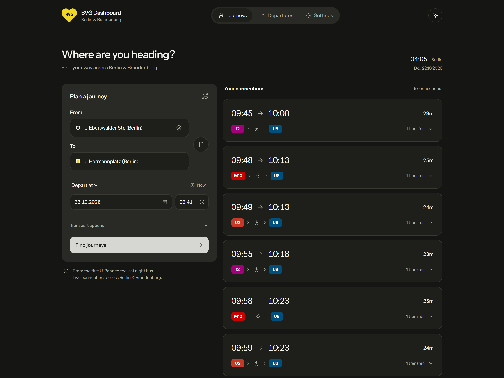
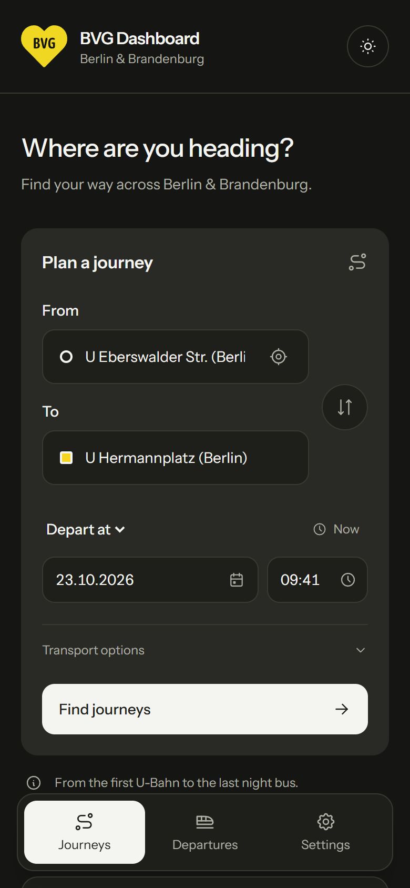
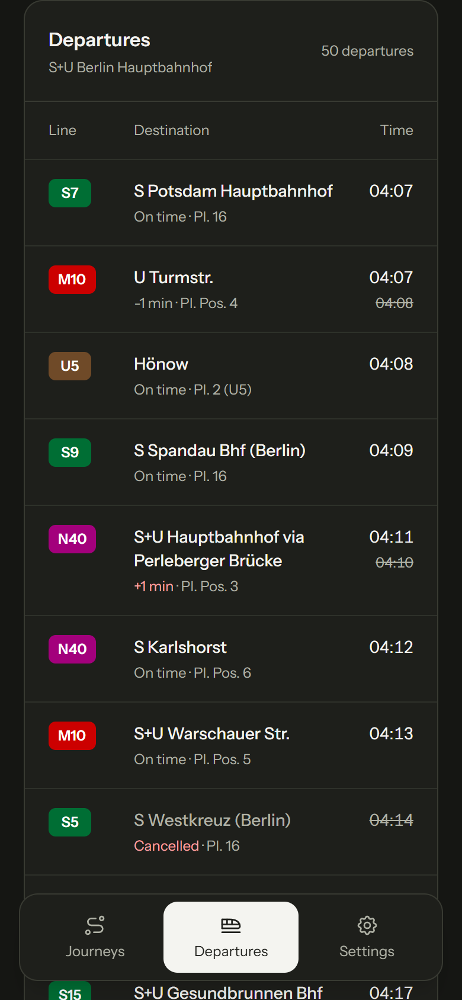
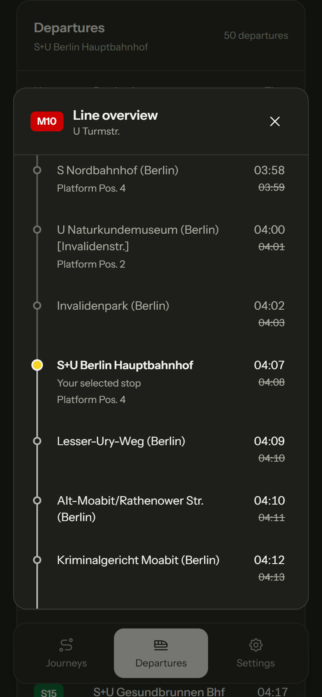
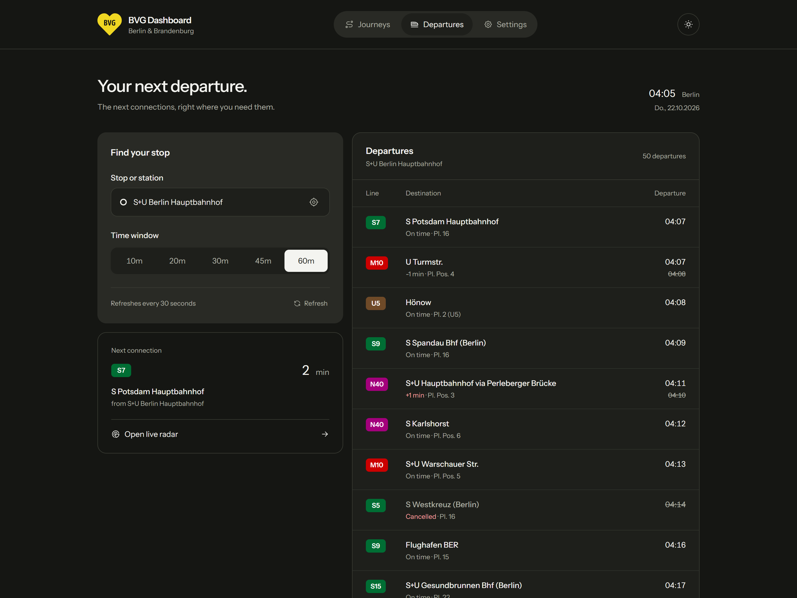

<p align="center">
  
</p>

<h1 align="center">BVG Dashboard</h1>

<p align="center">
  Your next connection, clearly.<br />
  Journey planning, live departures and vehicle radar for Berlin & Brandenburg.
</p>

<p align="center">
  <a href="https://bvg.tameraktas.de"><strong>Open the dashboard →</strong></a>
  &nbsp; · &nbsp;
  <a href="#on-your-phone">Mobile previews</a>
  &nbsp; · &nbsp;
  <a href="#run-locally">Run locally</a>
</p>



## One place for your next journey

Plan a route, check the next departure or follow vehicles around your station. The dashboard brings the useful details together, on your phone or at your desk.

| Plan your journey | Check your departures | Follow your connection |
| --- | --- | --- |
| Search stations, choose when to leave or arrive, and filter transport modes. | See times, platforms, delays and cancellations, with a quick choice of time windows. | Open the full stop list or switch to the vehicle radar around your selected station. |

- **Useful route details.** Transfers, walking and waiting times, platforms and intermediate stops in an expandable itinerary.
- **Faster station searches.** Station-only suggestions, nearby stops, keyboard navigation and fields that clear for editing and restore untouched selections.
- **Made for daily use.** German date formatting, a 24-hour time picker, saved preferences, light and dark themes, and reduced-motion support.

## On your phone

Journey planner, live departures and the full stop list. Select an image to see it at full size.

<p align="center">
  <a href="docs/screenshots/mobile-journeys.png"></a>
  <a href="docs/screenshots/mobile-departures.png"></a>
  <a href="docs/screenshots/mobile-line-overview.png"></a>
</p>

### Add it to your Home Screen

Open **Settings → Install app** in the dashboard. Supported browsers offer an installation button; other browsers show the relevant steps. On iPhone or iPad, open the dashboard in Safari, tap **Share → Add to Home Screen**, keep **Open as Web App** enabled if shown, and tap **Add**.

The installed app has its own icon and opens in a separate app window. Transit data and maps still need an internet connection; offline support is not included.

## At your desk

A wider departure board, the next connection at a glance, and the same controls in dark mode.



All five screenshots are browser captures of the running application in dark mode with real API responses. The times shown are captured examples, not a live departure board.

## Run locally

You’ll need **Node.js 22.18+** and npm. No API key or backend is required.

```sh
npm ci
npm run dev
```

Open the local address printed by Vite. To build and preview the production version:

```sh
npm run build
npm run preview
```

The static build is written to `dist/`. Transit requests and map tiles need an internet connection; nearby-station lookup needs location permission and HTTPS or localhost.

### Checks

```sh
npm test
npm run test:browser
```

Start the dev server before running the browser suite. It uses mocked transit responses for repeatable search, journey, departure, radar, persistence and error checks. Screenshots are saved in `.qa/`.

### Capture new README screenshots

With the dev server running:

```sh
npm run screenshots:readme
```

The script opens the real app, requests live transit data and takes two desktop and three mobile screenshots in `docs/screenshots/`. It uses installed Microsoft Edge by default. Both browser commands accept `QA_BASE_URL` and `QA_BROWSER_CHANNEL` to select another local server or installed Playwright browser channel.

To regenerate the app icons from the existing Tabler train favicon, run `node scripts/generate-app-icons.mjs`. This also uses installed Microsoft Edge by default and accepts `QA_BROWSER_CHANNEL`.

## Built with

**Vue 3 · Vite · Tailwind CSS v4 · Tabler Icons · Leaflet**

Transit data comes from [transport.rest](https://v6.bvg.transport.rest/api.html). Departures refresh every 30 seconds; radar refreshes every 10 seconds while open. Refresh timers pause when the tab is hidden, and superseded requests are cancelled.

```text
src/
├── App.vue                    # Journey planner, departures and settings
├── components/                # Search, route details, dialogs and shared UI
├── composables/useTransit.js  # Transit state and request lifecycle
├── lib/                       # Data validation, route helpers and local storage
└── styles.css                 # Tailwind theme and interaction styles
scripts/capture-readme.mjs     # Actual browser screenshot capture
docs/screenshots/              # README images
```

<details>
<summary><strong>Deployment</strong></summary>

The GitHub Actions workflow tests and builds the app, then deploys `dist/` after pushes to `main` or a manual run on `main`. Pull requests and manual runs on other branches run the build checks without deploying.

In repository **Settings → Pages**, use **GitHub Actions** and keep `bvg.tameraktas.de` as the custom domain. This root-domain setup uses Vite’s default base path and does not need a repository `CNAME` file. A deployment to the default project URL at `https://tameraktasTU.github.io/BVG-Dashboard/` requires a Vite base of `/BVG-Dashboard/` before rebuilding.

For another static host, upload the complete contents of `dist/`. Verify the remote workflow and deployment in GitHub after pushing.

</details>

## Credits

Created by [Tamer Aktas](https://tameraktas.de). Independent project, not an official BVG application.

- **Transit data:** [transport.rest](https://v6.bvg.transport.rest).
- **Typeface:** locally bundled [Instrument Sans](https://fonts.google.com/specimen/Instrument+Sans).
- **Icons:** [Tabler Icons](https://tabler.io/icons), MIT licensed.
- **Maps:** [Leaflet](https://leafletjs.com), [OpenStreetMap](https://www.openstreetmap.org/copyright) and Esri Dark Gray Canvas. Attribution remains on the map.
- **BVG brand mark:** [theSVG catalog](https://thesvg.org/icon/bvg). The logo identifies the transit network; all brand rights remain with their owner.
